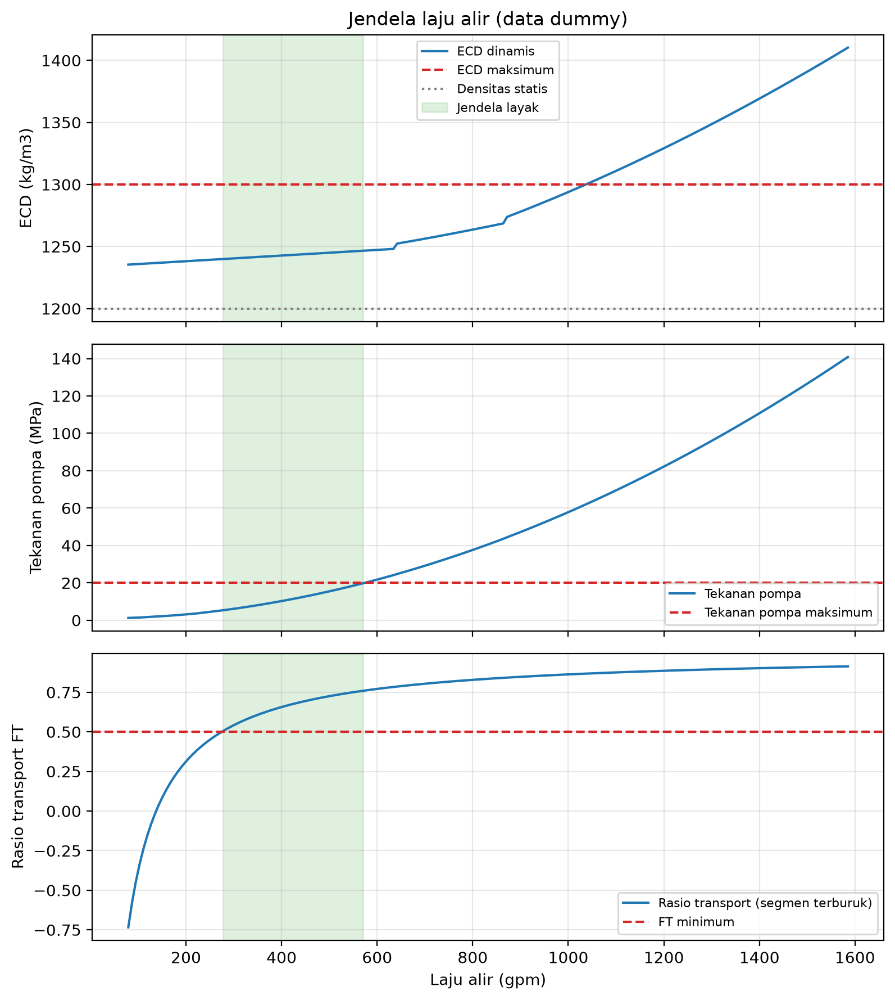
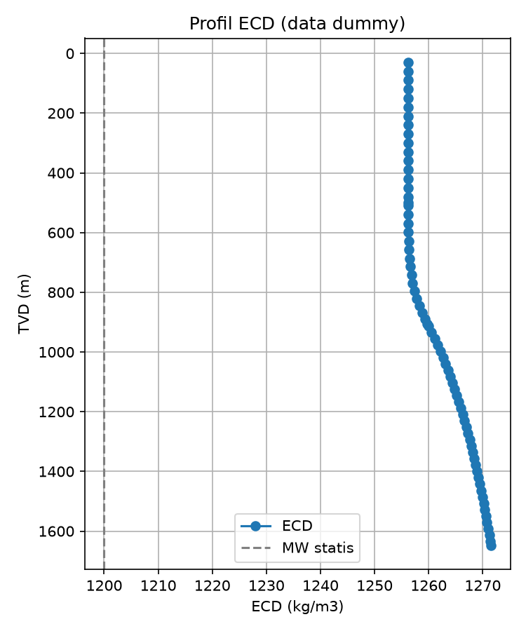
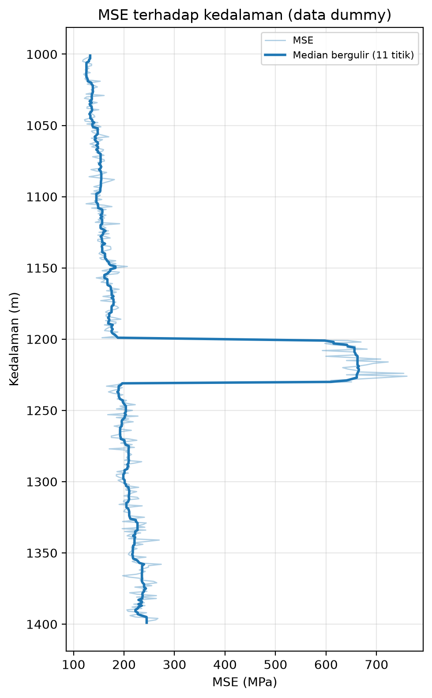
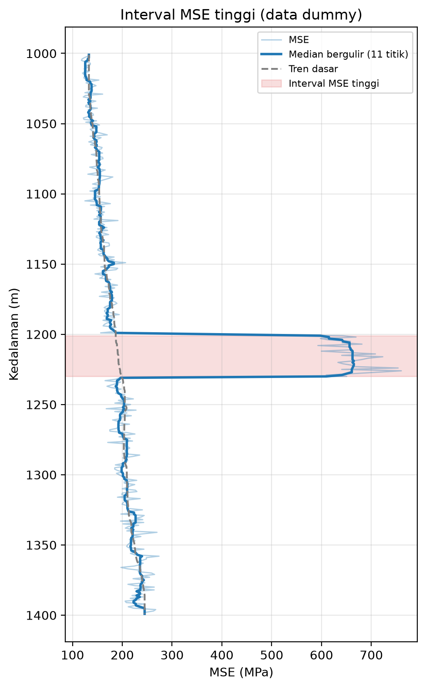

# Drilling Toolkit


Kumpulan modul Python untuk perhitungan teknik pemboran, dibangun bertahap dan diuji dengan `pytest`. Saat ini berisi tiga bagian utama:

- **Trajectory**: desain profil sumur sintetis (tipe J dan S) dan trajectory dari data survei dengan metode minimum curvature (TVD, Northing, Easting, DLS, vertical section, closure), lengkap dengan grafik 2D dan 3D.
- **Hidrolika lumpur**: tekanan hidrostatik, reologi Bingham, ECD statis dan dinamis, tekanan pompa, hole cleaning, jendela laju alir, dan profil ECD sepanjang sumur yang memakai hasil trajectory (MD untuk gesekan, TVD untuk hidrostatik).
- **MSE**: Mechanical Specific Energy dari parameter pemboran, pembacaan log CSV, penyaringan data, dan deteksi interval dengan MSE jauh di atas tren dasar.

Status: trajectory, hidrolika (tahap 2.1 sampai 2.7), dan MSE (tahap 3.1 sampai 3.3) selesai. Semua contoh data bersifat sintetis. Penyambungan ke data lapangan belum dilakukan.

## Struktur

```
drilling-toolkit/
├── .github/workflows/
│   └── tests.yml            # menjalankan pytest otomatis di GitHub Actions
├── src/
│   ├── __init__.py
│   ├── design.py            # profil sumur sintetis tipe J dan S (tabel MD, INC, AZI)
│   ├── hydraulics.py        # hidrostatik, reologi, ECD, pompa, hole cleaning
│   ├── well_hydraulics.py   # profil ECD sepanjang sumur dari hasil trajectory
│   ├── mse.py               # MSE, pembaca CSV, filter, tren dasar, interval tinggi
│   ├── plots.py             # plot trajectory, jendela laju alir, dan MSE
│   ├── trajectory.py        # minimum curvature, DLS, vertical section, closure
│   └── units.py             # konversi satuan lapangan <-> SI
├── tests/
│   ├── test_design.py
│   ├── test_hydraulics.py
│   ├── test_regime_monotonic.py
│   ├── test_well_hydraulics.py
│   ├── test_mse.py
│   ├── test_mse_data.py
│   ├── test_mse_intervals.py
│   ├── test_plot.py
│   └── test_trajectory.py
├── data/                    # data masukan (dummy_drilling_log.csv adalah data sintetis)
├── outputs/                 # hasil: gambar (well_2d, well_3d, ecd_window, ecd_profile,
│                            #   mse_depth, mse_intervals) dan tabel (trajectory_result.csv,
│                            #   mse_intervals.csv)
├── main.py                  # contoh trajectory
├── demo_window.py           # contoh jendela laju alir
├── demo_ecd_profile.py      # contoh profil ECD sepanjang sumur
├── make_dummy_log.py        # pembuat log pemboran sintetis
├── demo_mse.py              # contoh MSE terhadap kedalaman
├── demo_intervals.py        # contoh deteksi interval MSE tinggi
├── requirements.txt
├── pytest.ini
└── README.md
```

## Instalasi dan pemakaian

    python -m venv .venv
    .venv\Scripts\Activate.ps1
    pip install -r requirements.txt

    python main.py                # trajectory sumur contoh
    python demo_window.py         # jendela laju alir (data dummy)
    python demo_ecd_profile.py    # profil ECD sepanjang sumur (data dummy)
    python make_dummy_log.py      # membuat data/dummy_drilling_log.csv
    python demo_mse.py            # MSE terhadap kedalaman (data dummy)
    python demo_intervals.py      # interval MSE tinggi (data dummy)
    pytest                        # jalankan semua tes

Skrip demo yang membuat gambar menyimpannya ke `outputs/` lalu membuka jendela plot. Tutup jendela itu agar skrip selesai.

## Modul trajectory

Menghitung trajectory sumur dari data survei dengan metode minimum curvature. `src/design.py` membuat tabel survei sintetis (kolom MD, INC, AZI) untuk profil tipe J (kick-off, build, lalu hold) dan tipe S (build, hold, lalu drop).

### Persamaan

- Sudut dogleg: cos β = cos(I2 - I1) - sin I1 sin I2 (1 - cos(A2 - A1))
- Ratio factor: RF = (2/β) tan(β/2)
- ΔN, ΔE, ΔTVD = (ΔMD/2)(komponen arah stasiun 1 + stasiun 2) x RF
- DLS = β / ΔMD x 30 m

### Konvensi

Inklinasi dari vertikal (deg), azimuth dari utara searah jarum jam (deg), MD dan TVD dalam meter, DLS dalam deg/30 m. Azimuth diasumsikan sudah dikoreksi ke acuan koordinat yang sama.

### Validasi

8 tes trajectory: sumur vertikal, interval lurus, busur 90° (hasil harus sama dengan jari-jari), sifat fisik (MD >= TVD, jarak lurus <= MD), closure, vertical section, dan pembacaan CSV. 4 tes desain memeriksa profil J dan S.

### Contoh hasil


### Keterbatasan

Model deterministik: tanpa ketidakpastian survei (ellipse of uncertainty). Data contoh bersifat sintetis.

## Modul hidrolika

Semua fungsi di `src/hydraulics.py` dan `src/well_hydraulics.py` memakai satuan SI. Konversi dari satuan lapangan ada di `src/units.py`.

### Fungsi

| Tahap | Fungsi | Isi |
|---|---|---|
| 2.1 | `hydrostatic_pressure`, `ecd` | tekanan hidrostatik dan ECD (skalar atau array) |
| 2.2a | `pipe_area`, `annulus_area`, `mean_velocity` | luas penampang dan kecepatan rata-rata |
| 2.2b | `bingham_dpdl_pipe`, `bingham_dpdl_annulus` | gradien tekanan Bingham, aliran laminar |
| 2.2c | `reynolds_pipe`, `reynolds_annulus`, `turbulent_dpdl_*`, `dpdl_pipe`, `dpdl_annulus` | Reynolds (untuk pelaporan), gesekan turbulen, gradien tekanan = nilai yang lebih besar antara laminar dan turbulen |
| 2.3 | `annulus_pressure_loss`, `ecd_dynamic` | kehilangan tekanan annulus multi-segmen dan ECD dinamis (`ecd_dynamic` adalah alias dari `ecd`) |
| 2.4 | `pipe_pressure_loss`, `total_flow_area`, `bit_pressure_drop`, `hydraulic_power`, `pump_pressure` | tekanan pipa, nozzle bit, dan tekanan pompa total |
| 2.5 | `slip_velocity`, `transport_ratio`, `min_flow_rate_hole_cleaning`, `flow_rate_window` | hole cleaning dan jendela laju alir (hasil menyertakan flag `contiguous`) |
| 2.6 | `plot_flow_window` (di `src/plots.py`) | plot ECD, tekanan pompa, dan rasio transport |
| 2.7 | `ecd_profile` (di `src/well_hydraulics.py`) | ECD di setiap stasiun survei dari tabel trajectory |

### Persamaan utama

- Pipa (laminar, Bingham): dP/dL = 32 x PV x v / D² + 16 x YP / (3 x D)
- Annulus (laminar, celah sempit): dP/dL = 48 x PV x v / celah² + 6 x YP / celah
- Viskositas efektif: pipa μe = PV + YP x D / (6 x v); annulus μe = PV + YP x celah / (8 x v)
- Reynolds: pipa Re = ρ x v x D / μe; annulus Re = ρ x v x (0,8165 x celah) / μe
- Turbulen (Blasius): f = 0,0791 / Re^0,25; dP/dL = 2 x f x ρ x v² / D (annulus: D diganti 0,8165 x celah, Re memakai PV)
- Gradien tekanan yang dipakai: dP/dL = maks(laminar, turbulen). Hasilnya kontinu dan naik terhadap kecepatan (lihat `tests/test_regime_monotonic.py`).
- ECD dinamis: ECD = ρ + APL / (g x TVD). Gesekan memakai MD, hidrostatik memakai TVD.
- Bit: ΔP = ρ x Q² / (2 x Cd² x TFA²), Cd = 0,95
- Kecepatan jatuh serpihan: v_slip = √(4 x g x d x (ρ_serpih - ρ) / (3 x Cd x ρ)), Cd serpihan = 1,5
- Rasio transport: FT = 1 - v_slip / v_annulus

### Contoh

```python
from src.hydraulics import flow_rate_window
from src.plots import plot_flow_window
from src.units import nozzle32_to_m

pipe = [(1000, 0.1086), (200, 0.0714)]          # (panjang m, ID m)
ann = [(1000, 0.25, 0.127), (200, 0.25, 0.18)]  # (panjang m, d lubang m, d pipa m)
nozzles = [nozzle32_to_m(13)] * 3

res = flow_rate_window(1200, pipe, ann, nozzles, 0.025, 6.0,
                       tvd=1200, ecd_max=1300.0, p_max=20.0e6,
                       d_cut=0.006, rho_cut=2500, ft_min=0.5, p_surface=1.0e5)
print(res['window'])        # (q_min, q_max) dalam m3/s, atau None
print(res['contiguous'])    # True bila semua titik di dalam window memenuhi batas
```



### Hidrolika sepanjang sumur

`ecd_profile` menggabungkan trajectory dengan hidrolika. Gesekan annulus bergantung pada panjang lintasan (MD), sedangkan tekanan hidrostatik bergantung pada kedalaman vertikal (TVD). Di sumur miring MD lebih panjang dari TVD, sehingga ECD pada MD yang sama lebih tinggi daripada di sumur vertikal.

APL di kedalaman MD_i dihitung dari jumlah (gradien tekanan x panjang interval di atas MD_i), lalu ECD_i = ρ + APL_i / (g x TVD_i).

```python
from src.design import design_j_well
from src.trajectory import minimum_curvature
from src.well_hydraulics import ecd_profile

design = design_j_well(kop=500, dls=3, inc_final=45, azi=45, td=2000)
survey = minimum_curvature(design['MD'], design['INC'], design['AZI'])

# (MD atas, MD bawah, d lubang atau ID casing, d pipa), semuanya dalam m, dari permukaan ke bawah
intervals = [(0.0, 800.0, 0.22, 0.127),
             (800.0, 2000.0, 0.2159, 0.127)]

prof = ecd_profile(survey, rho=1200.0, q=0.03, intervals=intervals, pv=0.025, yp=6.0)
print(prof[['MD', 'TVD', 'APL', 'ECD']].tail(1))   # baris TD
```



### Asumsi dan keterbatasan

- Model reologi Bingham Plastic, dengan pendekatan celah sempit untuk annulus.
- Pemilihan rezim aliran memakai nilai yang lebih besar antara gradien laminar (Bingham) dan turbulen (Blasius), bukan batas Re tetap. Ini menghilangkan lompatan gesekan di batas rezim, tetapi titik pergantiannya adalah hasil perpotongan kedua kurva dan belum divalidasi terhadap contoh API RP 13D. Metode bilangan Hedstrom atau Power Law adalah alternatif yang lebih baku.
- Gesekan turbulen memakai korelasi Blasius (dinding halus). Kehilangan tekanan di tool joint, eksentrisitas pipa, dan model Power Law belum dihitung.
- Hole cleaning hanya untuk sumur vertikal (rezim Newton). Hasilnya konservatif di laju rendah. Sumur miring perlu model lain.
- Batas rasio transport (default 0,5) adalah aturan praktis, bukan hukum.
- Pencarian jendela laju alir memakai pemindaian grid. Hasilnya menyertakan `contiguous` agar rentang yang berlubang tidak dilaporkan sebagai satu jendela.
- Profil ECD: laju alir dan sifat lumpur dianggap seragam di seluruh sumur; TVD antar stasiun diinterpolasi linear (cukup akurat bila stasiun rapat); diameter pipa konstan per interval (drill collar atau HWDP bisa ditambahkan sebagai interval terpisah); efek suhu tidak dimodelkan.
- Data di tes dan di `demo_window.py` serta `demo_ecd_profile.py` adalah data dummy, bukan data lapangan.

## Modul MSE

Menghitung Mechanical Specific Energy (MSE) dari parameter pemboran, membaca log CSV, menyaring baris yang bukan pemboran aktif, dan menandai interval dengan MSE jauh di atas tren dasar.

### Persamaan

- MSE (Teale, 1965) = WOB / A + 2π x N x T / (A x ROP)
- A = π/4 x d_bit²; N dalam putaran/detik; T dalam N·m; ROP dalam m/s; hasil dalam Pa
- Rumus lapangan (psi): WOB/A + 120π x N x T / (A x ROP), dengan N dalam rpm dan ROP dalam ft/jam. Konstanta 120π hanya konversi satuan dari rumus yang sama.
- Efisiensi mekanis = CCS / MSE
- Tren dasar = median bergulir lebar dari MSE. Interval ditandai jika MSE >= rasio x tren selama rentang minimum tertentu.

### Fungsi (`src/mse.py`)

| Tahap | Fungsi | Isi |
|---|---|---|
| 3.1 | `bit_area`, `mse_axial`, `mse_rotary`, `mse`, `mse_breakdown`, `mse_efficiency` | MSE total, suku aksial dan rotari, efisiensi mekanis |
| 3.2 | `read_drilling_csv`, `filter_on_bottom`, `mse_series`, `rolling_median` | baca CSV (satuan wajib disebut, diubah ke SI), buang baris sambungan dan sel kosong, MSE per baris, median bergulir |
| 3.2 | `plot_mse_depth` (di `src/plots.py`) | plot MSE terhadap kedalaman |
| 3.3 | `baseline_trend`, `find_high_mse_intervals`, `write_intervals_csv` | tren dasar, interval MSE tinggi, tabel ringkasan CSV |
| 3.3 | `plot_mse_intervals` (di `src/plots.py`) | plot dengan tren dasar dan interval diarsir |

### Contoh

```python
from src.mse import (baseline_trend, filter_on_bottom, find_high_mse_intervals,
                     mse_series, read_drilling_csv)
from src.units import in_to_m

columns = {'depth': 'depth_m', 'wob': 'wob_kN', 'torque': 'torque_kNm',
           'rpm': 'rpm', 'rop': 'rop_mh'}
units = {'depth': 'm', 'wob': 'kn', 'torque': 'knm', 'rpm': 'rpm', 'rop': 'm/h'}

data, mask = filter_on_bottom(read_drilling_csv('data/dummy_drilling_log.csv', columns, units))
m = mse_series(data, in_to_m(8.5))
intervals = find_high_mse_intervals(data['depth'], m, baseline_trend(m, 101),
                                    ratio=1.5, min_length=10.0)
```




### Asumsi dan keterbatasan

- Data di `data/dummy_drilling_log.csv` bersifat sintetis (dibuat oleh `make_dummy_log.py`), bukan data lapangan.
- Torsi dan RPM permukaan dianggap sama dengan di bit. Di sumur miring, torsi permukaan lebih besar dari torsi bit karena gesekan drill string, sehingga MSE cenderung terhitung terlalu tinggi. Dengan motor downhole, RPM di bit juga berbeda.
- Model MSE Teale tidak memasukkan hidrolika bit.
- Satuan di CSV wajib disebut eksplisit saat membaca, supaya tidak salah tebak.
- `filter_on_bottom` hanya menolak nilai tidak terhingga dan nilai di bawah batas minimum (bawaan 0). Kriteria pemboran aktif yang lebih ketat perlu disesuaikan dengan datanya.
- Jendela tren harus lebih dari dua kali panjang anomali terpanjang (dalam titik); kalau tidak, anomali menarik tren dan tidak terdeteksi.
- Interval yang ditandai hanyalah kandidat. Lonjakan MSE bisa berarti batuan keras, bit tumpul, founder, atau getaran, dan modul ini tidak bisa membedakannya tanpa data pembanding (litologi, CCS).
- Ambang rasio 1,5 dan panjang minimum 10 m adalah pilihan awal, bukan standar.

## Konvensi umum

- Hidrolika dan MSE: satuan internal selalu SI (m, m3/s, Pa, kg/m3, Pa.s, N, N.m). Konversi hanya di `src/units.py`, dan satuan data CSV wajib disebut saat membaca.
- Trajectory: sudut dalam derajat, DLS dalam deg/30 m (lihat bagian trajectory).
- Nama file tes diawali `test_`, dan modul sumber harus bisa diimpor sebagai `src.<modul>`.
- Setiap fungsi baru mendapat tes yang bisa dicek dengan hitungan manual dan, bila ada, dibandingkan dengan rumus lapangan.
- Tes tidak hanya memeriksa nilai tunggal, tetapi juga sifat fisik yang harus selalu benar (misalnya gesekan naik terhadap kecepatan, MD >= TVD).

## Validasi

`pytest` menjalankan 98 tes: 4 desain, 8 trajectory, 39 hidrolika, 10 rezim aliran (monoton dan batas rezim), 6 hidrolika sepanjang sumur, 4 plot, dan 27 MSE (10 inti, 9 data dan plot, 8 interval). Hasil yang diharapkan saat ini: 98 passed. Tes yang sama berjalan otomatis di GitHub Actions pada setiap push (lihat badge di atas).

## Referensi

- Sawaryn, S. J. & Thorogood, J. L. (2005). SPE 84246.
- Taylor, H. L. & Mason, M. C. (1972). SPE 3362.
- Bourgoyne, A. T. (1986). *Applied Drilling Engineering*. SPE Textbook Series.
- API RP 13D. *Rheology and Hydraulics of Oil-well Drilling Fluids*.
- Moore, P. L. (1974). *Drilling Practices Manual*.
- Teale, R. (1965). The concept of specific energy in rock drilling. *International Journal of Rock Mechanics and Mining Sciences*, 2(1), 57-73.

Cek edisi dan nomor halaman langsung di sumbernya sebelum dikutip di laporan.