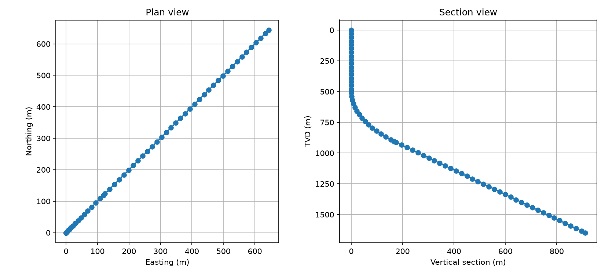
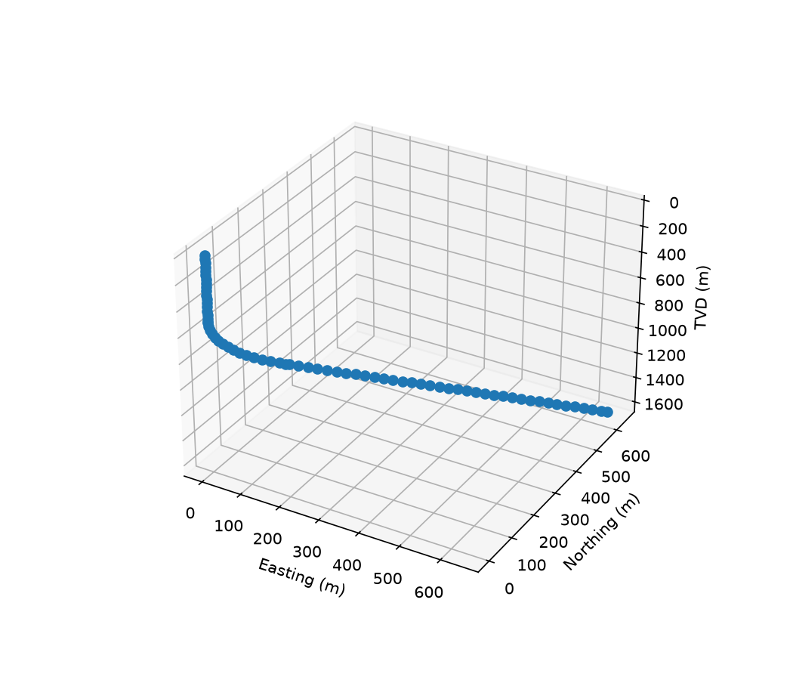

# Drilling Toolkit

Kumpulan modul Python untuk perhitungan teknik pemboran, dibangun bertahap dan diuji dengan `pytest`. Saat ini berisi dua bagian utama:

- **Trajectory**: trajectory sumur dari data survei dengan metode minimum curvature (TVD, Northing, Easting, DLS, vertical section, closure), lengkap dengan grafik 2D dan 3D.
- **Hidrolika lumpur**: tekanan hidrostatik, reologi Bingham, ECD statis dan dinamis, tekanan pompa, hole cleaning, dan jendela laju alir.

Status: trajectory dan hidrolika (tahap 2.1 sampai 2.6) selesai. Modul MSE belum dimulai.

## Struktur

```
drilling-toolkit/
├── src/
│   ├── __init__.py
│   ├── design.py        # (lengkapi: deskripsi singkat modul ini)
│   ├── hydraulics.py    # hidrostatik, reologi, ECD, pompa, hole cleaning
│   ├── plots.py         # plot trajectory dan jendela laju alir
│   ├── trajectory.py    # minimum curvature, DLS, vertical section, closure
│   └── units.py         # konversi satuan lapangan <-> SI
├── tests/
│   ├── test_design.py
│   ├── test_hydraulics.py
│   ├── test_plots.py
│   └── test_trajectory.py
├── outputs/             # gambar hasil (well_2d.png, well_3d.png, ecd_window.png)
├── main.py              # contoh trajectory
├── demo_window.py       # contoh jendela laju alir
├── requirements.txt
├── pytest.ini
└── README.md
```

## Instalasi dan pemakaian

    python -m venv .venv
    .venv\Scripts\Activate.ps1
    pip install -r requirements.txt

    python main.py            # trajectory sumur contoh
    python demo_window.py     # jendela laju alir (data dummy)
    pytest                    # jalankan semua tes

## Modul trajectory

Menghitung trajectory sumur dari data survei dengan metode minimum curvature.

### Persamaan

- Sudut dogleg: cos β = cos(I2 - I1) - sin I1 sin I2 (1 - cos(A2 - A1))
- Ratio factor: RF = (2/β) tan(β/2)
- ΔN, ΔE, ΔTVD = (ΔMD/2)(komponen arah stasiun 1 + stasiun 2) x RF
- DLS = β / ΔMD x 30 m

### Konvensi

Inklinasi dari vertikal (deg), azimuth dari utara searah jarum jam (deg), MD dan TVD dalam meter, DLS dalam deg/30 m. Azimuth diasumsikan sudah dikoreksi ke acuan koordinat yang sama.

### Validasi

8 tes: sumur vertikal, interval lurus, busur 90° (hasil harus sama dengan jari-jari), sifat fisik (MD >= TVD, jarak lurus <= MD), closure, vertical section, dan pembacaan CSV.

### Contoh hasil




### Keterbatasan

Model deterministik: tanpa ketidakpastian survei (ellipse of uncertainty). Data contoh bersifat sintetis.

## Modul hidrolika

Semua fungsi di `src/hydraulics.py` memakai satuan SI. Konversi dari satuan lapangan ada di `src/units.py`.

### Fungsi

| Tahap | Fungsi | Isi |
|---|---|---|
| 2.1 | `hydrostatic_pressure`, `ecd` | tekanan hidrostatik dan ECD statis |
| 2.2a | `pipe_area`, `annulus_area`, `mean_velocity` | luas penampang dan kecepatan rata-rata |
| 2.2b | `bingham_dpdl_pipe`, `bingham_dpdl_annulus` | gradien tekanan Bingham, aliran laminar |
| 2.2c | `reynolds_pipe`, `reynolds_annulus`, `turbulent_dpdl_*`, `dpdl_pipe`, `dpdl_annulus` | Reynolds, gesekan turbulen, pemilihan rezim otomatis |
| 2.3 | `annulus_pressure_loss`, `ecd_dynamic` | kehilangan tekanan annulus multi-segmen dan ECD dinamis |
| 2.4 | `pipe_pressure_loss`, `total_flow_area`, `bit_pressure_drop`, `hydraulic_power`, `pump_pressure` | tekanan pipa, nozzle bit, dan tekanan pompa total |
| 2.5 | `slip_velocity`, `transport_ratio`, `min_flow_rate_hole_cleaning`, `flow_rate_window` | hole cleaning dan jendela laju alir |
| 2.6 | `plot_flow_window` (di `src/plots.py`) | plot ECD, tekanan pompa, dan rasio transport |

### Persamaan utama

- Pipa (laminar, Bingham): dP/dL = 32 x PV x v / D² + 16 x YP / (3 x D)
- Annulus (laminar, celah sempit): dP/dL = 48 x PV x v / celah² + 6 x YP / celah
- Viskositas efektif: pipa μe = PV + YP x D / (6 x v); annulus μe = PV + YP x celah / (8 x v)
- Reynolds: pipa Re = ρ x v x D / μe; annulus Re = ρ x v x (0,8165 x celah) / μe
- Turbulen (Blasius): f = 0,0791 / Re^0,25; dP/dL = 2 x f x ρ x v² / D (annulus: D diganti 0,8165 x celah, Re memakai PV)
- ECD dinamis: ECD = ρ + APL / (g x TVD). Gesekan memakai MD, hidrostatik memakai TVD.
- Bit: ΔP = ρ x Q² / (2 x Cd² x TFA²), Cd = 0,95
- Kecepatan jatuh serpihan: v_slip = √(4 x g x d x (ρ_serpih - ρ) / (3 x Cd x ρ)), Cd serpihan = 1,5
- Rasio transport: FT = 1 - v_slip / v_annulus

### Contoh

```python
from src.hydraulics import flow_rate_window
from src.plots import plot_flow_window
from src.units import nozzle32_to_m

pipe = [(1000, 0.1086), (200, 0.0714)]          # (panjang m, ID m)
ann = [(1000, 0.25, 0.127), (200, 0.25, 0.18)]  # (panjang m, d lubang m, d pipa m)
nozzles = [nozzle32_to_m(13)] * 3

res = flow_rate_window(1200, pipe, ann, nozzles, 0.025, 6.0,
                       tvd=1200, ecd_max=1300.0, p_max=20.0e6,
                       d_cut=0.006, rho_cut=2500, ft_min=0.5, p_surface=1.0e5)
print(res['window'])    # (q_min, q_max) dalam m3/s, atau None
```


### Asumsi dan keterbatasan

- Model reologi Bingham Plastic, dengan pendekatan celah sempit untuk annulus.
- Batas laminar/turbulen memakai Re = 2100 (penyederhanaan). Kurva gesekan melompat sedikit di batas itu. Metode bilangan Hedstrom bisa memperhalusnya.
- Gesekan turbulen memakai korelasi Blasius (dinding halus). Kehilangan tekanan di tool joint, eksentrisitas pipa, dan model Power Law belum dihitung.
- Hole cleaning hanya untuk sumur vertikal (rezim Newton). Hasilnya konservatif di laju rendah. Sumur miring perlu model lain.
- Batas rasio transport (default 0,5) adalah aturan praktis, bukan hukum.
- Pencarian jendela laju alir memakai pemindaian grid karena gesekan tidak mulus di batas rezim.
- Data di tes dan di `demo_window.py` adalah data dummy, bukan data lapangan.

## Konvensi umum

- Hidrolika: satuan internal selalu SI (m, m3/s, Pa, kg/m3, Pa.s). Konversi hanya di `src/units.py`.
- Trajectory: sudut dalam derajat, DLS dalam deg/30 m (lihat bagian trajectory).
- Nama file tes harus `test_<modul>.py`, dan modul sumber harus bisa diimpor sebagai `src.<modul>`.
- Setiap fungsi baru mendapat tes yang bisa dicek dengan hitungan manual dan, bila ada, dibandingkan dengan rumus lapangan.

## Validasi

`pytest` menjalankan 55 tes: 4 desain, 8 trajectory, 39 hidrolika, dan 4 plot. Hasil yang diharapkan saat ini: 55 passed.

## Referensi

- Sawaryn, S. J. & Thorogood, J. L. (2005). SPE 84246.
- Taylor, H. L. & Mason, M. C. (1972). SPE 3362.
- Bourgoyne, A. T. (1986). *Applied Drilling Engineering*. SPE Textbook Series.
- API RP 13D. *Rheology and Hydraulics of Oil-well Drilling Fluids*.
- Moore, P. L. (1974). *Drilling Practices Manual*.

Cek edisi dan nomor halaman langsung di sumbernya sebelum dikutip di laporan.